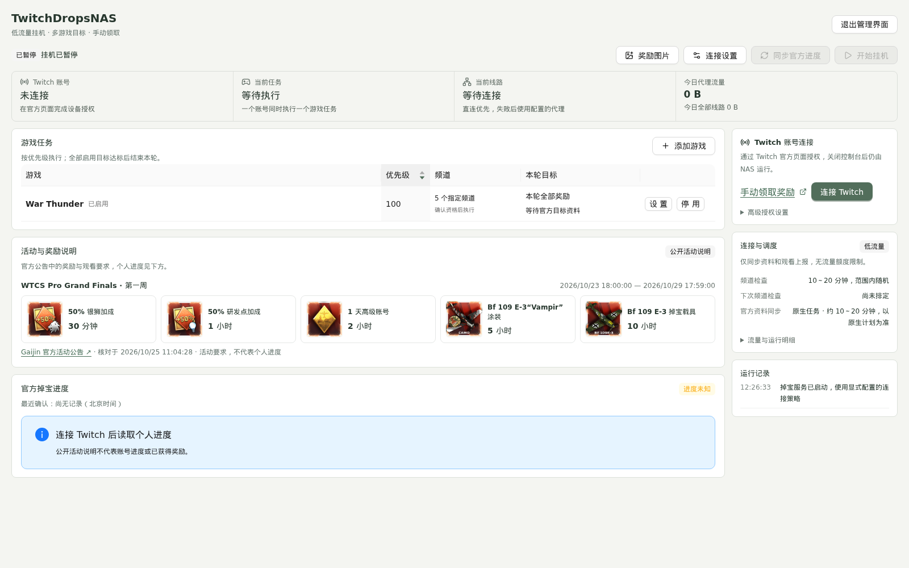
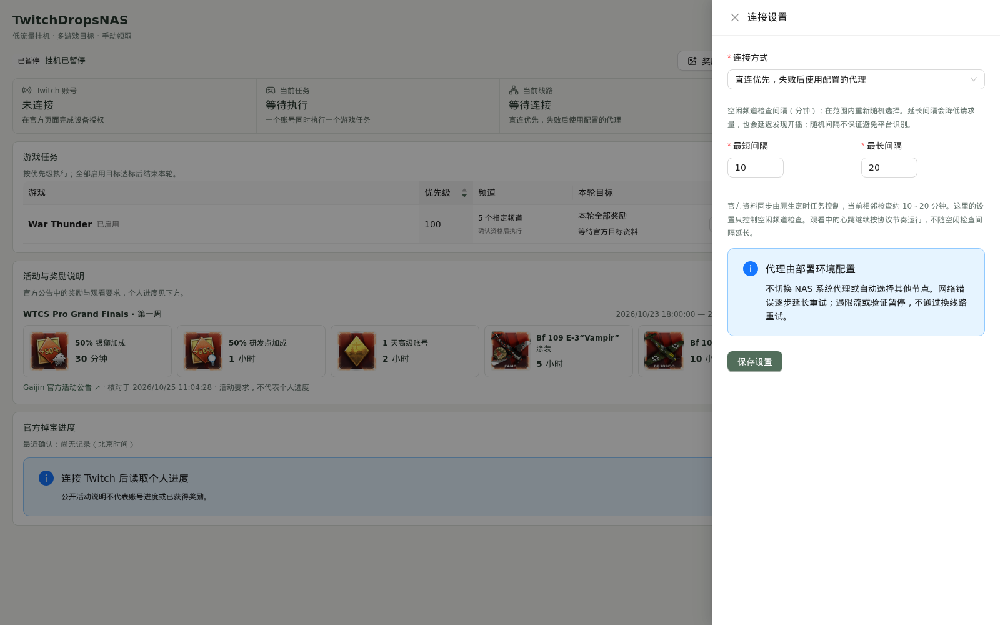
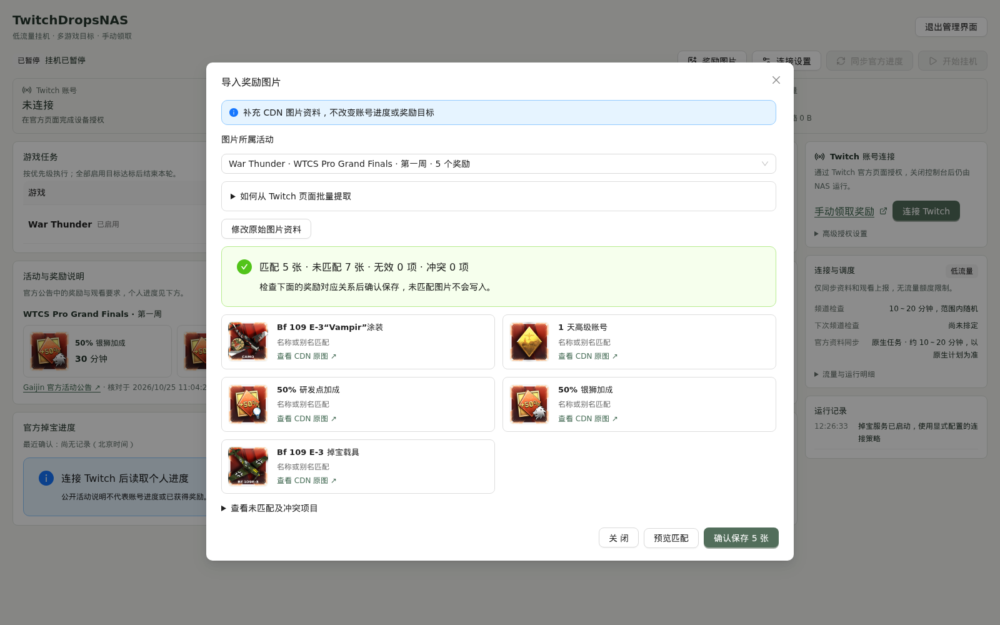

# TwitchDropsNAS

[简体中文](README.md) · English

A self-hosted Twitch Drops manager with Docker, a reusable Web UI, per-game reward goals, and an API for agents and existing admin consoles. MIT licensed.

Choose your own deployment target: your NAS/server or a compatible WorkBuddy execution environment. Each instance owns its user's accounts and data; it does not depend on the author's NAS, admin service, or proxy. WorkBuddy requires environment checks and has not been tested with this project. See [WorkBuddy deployment requirements](docs/workbuddy.md#english-summary) and the [agent prompt](docs/agent-prompt.md).

> **Experimental status:** Docker, the UI, and the management API have been verified. The current device authorization has not returned the campaign catalogue or personal Drops progress; normal web queries can require an integrity check. Successful authorization does not establish that Drops tracking works. Actual reward progress has not been validated during an eligible live stream. When personal progress is unavailable, automatic completion cannot be relied on.

## Screenshots

Captured from an isolated demo instance with no real Twitch account connected. They contain no personal nickname, NAS address, device code, or secret. Public reward descriptions are not evidence of earned rewards or watched minutes.







## Features

- Official Twitch device authorization. Approve the code on Twitch; the backend does not request your email or Twitch password.
- One account and up to 12 prioritized game tasks, with configured channels and optional channel discovery.
- Select all rewards in the current round or specific rewards from officially returned campaign data.
- All-reward mode freezes one round. Future campaigns are not silently added.
- Stop a goal after Twitch confirms it is claimed, claimable, or has reached the required watch time. All enabled tasks must have nonempty, achieved goals before the round ends.
- Wait for manual prerequisite claims while other runnable goals continue. Claiming is always manual.
- No video/audio/playlist downloads, browser playback, automatic claims, or hourly/daily traffic quotas.
- Public publisher announcements and private account progress are displayed separately.
- Reusable UI for standalone operation or embedding in an existing console.

## Run with Docker

```sh
git clone https://github.com/MrTreasure/TwitchDropsNAS.git
cd TwitchDropsNAS
docker compose up -d --build
# First installation only: read the generated management token in your own terminal.
docker compose exec drops cat /data/admin-token
```

Open <http://127.0.0.1:8080>, sign in with the management token, connect Twitch, approve the official device authorization, synchronize, configure a game and its goals, and start the queue. If Twitch does not return a capability, the UI reports it as unavailable.

For a remote NAS, an SSH tunnel keeps the default loopback binding:

```sh
ssh -L 8080:127.0.0.1:8080 user@your-nas
```

For an HTTPS reverse proxy, set `TDM_PUBLIC_ORIGIN=https://drops.example.com` and preserve the Host header. Browsers use an HttpOnly session cookie; agents use a management Bearer token. The management token and Twitch access token are different credentials.

Data lives in the `drops-data` Docker volume. Back it up before upgrades. Do not use `docker compose down -v` for an ordinary upgrade. The container runs as UID/GID 1000:1000; prepare writable host bind mounts for that UID if replacing the named volume.

## Network and low bandwidth

The default policy probes direct connectivity anonymously and falls back only to an explicitly configured HTTP/HTTPS proxy. Without a proxy, a failed direct connection is reported; the service does not discover or change the system proxy.

Copy `.env.example` to `.env` and set `TDM_PROXY_URL` to a proxy reachable from inside the container. Container `127.0.0.1` refers to the container itself.

Alternatively, mount your original mihomo configuration and compatible binary read-only. Configure `TDM_PROXY_SOURCE`, `TDM_PROXY_NODE`, and `TDM_MIHOMO`. Only the selected node is used; an in-memory Linux memfd holds the temporary configuration. No provider credentials are shipped or copied into generated disk files.

Idle channel checks default to a newly randomized 10–20 minute interval. The standalone metadata scheduler uses that range too. The external systemd example uses 10 minutes after the previous check finishes plus a random delay of up to 10 minutes, with a separate initial startup check. Random timing reduces synchronized requests; it is **not** a promise to avoid platform detection.

Active viewing heartbeats retain their protocol timing. TLS connections are reused, channel lookups are batched, inventories are normally cached for 30 minutes, catalogues for one hour, and campaign metadata for six hours. Manual synchronization can refresh immediately. Failed capabilities use retry caching; verification challenges are not bypassed. Traffic measurements are not carrier billing figures, and external proxy overhead is estimated.

## Goals and unknown progress

1. **All rewards:** freeze the current visible campaign rewards. If metadata has not arrived, wait for the first complete set. Future campaigns are not added automatically.
2. **Selected rewards:** choose known reward IDs belonging to the selected game. IDs are never invented from names or screenshots.
3. **Completion:** trust Twitch-confirmed account data. Local elapsed time and successful watch POSTs do not establish watched minutes.
4. **Prerequisites:** only the chosen goal's dependency chain blocks it. Other runnable branches remain eligible.
5. **End of round:** persist completion after all enabled tasks have achieved their nonempty goals. Restarting does not restart a completed round. Change goals before beginning another round.
6. **Unknown/expired:** an unavailable field, null list, or expired unfinished campaign is never treated as complete.

Explicit watch-only mode is available after the user checks game linkage and channel eligibility. It does not guarantee Drops or automatic completion. VOD playback does not count; eligible live broadcasts are required.

## Public announcements versus account progress

`catalogue/announcements.json` contains manually checked public notices with source URLs and verification timestamps. The included War Thunder WTCS 2026 first-week notice lists five rewards from the publisher's official announcement; the activity window was checked against the Twitch listing.

These records contain **no** personal watch time, claim state, account linkage, or Twitch reward IDs. They never enter automatic goal-completion logic. Administrators can add other games in the same format or configure `TDM_ANNOUNCEMENTS_FILE`.

Campaign discovery, campaign details, and personal inventory have separate capability handling. A null response is not an empty catalogue. Data confirmed earlier retains its original source time. The service does not switch client identities, generate integrity tokens, or work around verification requirements.

## Embed into an existing console

Run the same Docker backend with `TDM_HTTP_PORT=0` and mount the owner-only Unix socket into a trusted gateway. The gateway retains its existing login, administrator checks, Origin checks, and method/path allowlist. Do not expose that socket directly.

Export `ui/src/TwitchDrops.tsx` and its CSS with `scripts/export-ui.py`; pass `apiBase` and optional scheduler navigation props. Keep host login and navigation in a small wrapper. The standalone and embedded business components remain identical.

See [embedding instructions](docs/embedding.md), [API documentation](docs/api.md), and [OpenAPI](docs/openapi.json).

## Scheduling and agent integration

Standalone scheduling exposes real enable/disable state and execution timestamps through `/api/automation`. Metadata synchronization and the watch queue are separate controls.

If a host already uses cron, systemd, or a task registry, set `TDM_EXTERNAL_SCHEDULER=true`, retain exactly one native executor, and register/control that executor in the host's task console. The `deploy/` directory contains systemd examples. Disabling metadata synchronization does not stop viewing; use the queue's Pause action for that.

The copyable [agent integration prompt](docs/agent-prompt.md) covers deployment, existing-console integration, official human approval, capability verification, goal selection, scheduling, and secret handling. Agents must not infer reward progress or bypass platform checks.

## Configuration

| Variable | Default / purpose |
|---|---|
| `TDM_DATA_DIR` | `/data`; private state and standalone credential storage |
| `TDM_SOCKET` | `/run/twitch-drops/service.sock`; mode 0600 |
| `TDM_WEB_UI` | `true`; disable standalone pages while retaining APIs and background tasks |
| `TDM_HTTP_PORT` | `8080`; use `0` to disable standalone TCP/UI |
| `TDM_HTTP_HOST` | `0.0.0.0` inside the container; Compose binds the host port to loopback |
| `TDM_ADMIN_TOKEN` | Optional, at least 24 characters; otherwise generated in `/data/admin-token` |
| `TDM_PUBLIC_ORIGIN` | Optional full origin for an HTTPS reverse proxy |
| `TDM_PROXY_URL` | Optional explicit HTTP/HTTPS proxy; mutually exclusive with an embedded mihomo node |
| `TDM_PROXY_SOURCE` / `TDM_PROXY_NODE` | Optional original mihomo config and explicit node name |
| `TDM_MIHOMO` | `/usr/local/bin/mihomo`; mount your compatible binary read-only |
| `TDM_PROXY_LABEL` | Optional non-sensitive label displayed by the UI |
| `TDM_EXTERNAL_SCHEDULER` | `false`; use `true` for a single native scheduler |
| `TDM_EXTERNAL_CHECK_MIN_SECONDS` / `TDM_EXTERNAL_CHECK_MAX_SECONDS` | Displayed external schedule range, default 600 / 1200; must reflect the real native schedule |
| `TDM_ANNOUNCEMENTS_FILE` | Optional administrator-owned public announcement JSON |
| `TDM_PASSWORD_BOOK` | Optional YAML host adapter modifying only `twitch_drops.account`; otherwise `/data/credentials.json` |

The UI can configure the idle-check range. In standalone mode it also controls metadata synchronization; in external mode the native schedule remains authoritative.

## Account authorization and unavailable progress

The UI guides missing or expired accounts through official device authorization. A connected account with unreadable progress instead gets official inventory/game-linking links and clear guidance; no extra ordinary-viewer progress permission has been confirmed. Reauthorizing is not a guaranteed fix. See [authorization states](docs/authorization.md).

## Release downloads and Web UI choice

Release archives cover Linux amd64/arm64, Windows amd64/arm64, and macOS Intel/Apple Silicon, with SHA256SUMS. Verify the checksum before extracting. Running an archive needs no Python, Go, Node.js or Docker; consult release notes for actual platform validation status.

Interactive terminal launches ask whether to start the standalone Web UI. For unattended launches, choose explicitly:

```sh
./twitch-drops --web-ui=true
./twitch-drops --web-ui=false
```

Use `twitch-drops.exe` on Windows or set `TDM_WEB_UI=true/false`. Disabling the UI makes `/` and `/assets/*` return 404; authenticated APIs and background tasks continue. For an existing admin console, disable this standalone UI and reuse the embedded component. `TDM_HTTP_PORT=0` additionally disables TCP and requires a trusted Unix socket.

## Go executable and development

The Go backend embeds its UI, public notices and OpenAPI document. Running it needs no Python, Node.js or separate SQLite service. Building from source needs Go 1.26.5, Node.js 26 and pnpm 12.3.4:

```sh
sh scripts/build.sh
./dist/twitch-drops
# In another private terminal after first startup; do not paste the token into chat
cat data/admin-token
```

Native defaults: `127.0.0.1:8080`, private state in `./data`, Unix socket disabled. Set `TDM_DATA_DIR` for persistent storage; set `TDM_SOCKET` only for a trusted local gateway or native scheduler. A Windows-targeted build uses an `.exe` with no Unix socket. Cross compilation is verified; actual Windows/macOS runtime acceptance remains unverified. The optional embedded mihomo adapter needs Linux; other systems use direct access or an explicit HTTP/HTTPS proxy.

Routine verification: `go vet ./...`, `go build ./...`, UI typecheck/build, and bounded health/API probes. Browser interaction acceptance is manual unless requested. Documentation screenshots use an isolated demo instance.

`Dockerfile` builds UI and Go in separate build stages. After `sh scripts/build.sh`, use `docker build -f Dockerfile.runtime -t twitch-drops-nas:2.0.0 .` for the compact runtime image. Runtime images contain no Python, Node.js or Go compiler. Dependencies are pinned in `go.mod`, `go.sum` and the UI lockfile.

## Upgrading from Python 1.x

Go 2.x reads the existing SQLite schema, private JSON credentials or explicitly configured YAML adapter, and management token. Management cookie signatures and API paths remain compatible. Reward goals, unknown progress, imported image URLs and scheduler state are preserved.

Stop the old instance and back up its private data directory/volume before upgrading. Run only one instance per directory and never delete the volume during an upgrade. Replace Python health commands with `twitch-drops health`, and the native scheduler command with `twitch-drops sync`; keep its unique schedule and verify registration/control. Old Python commands cannot run in the Go image. Keep Python 1.x sources and old images until Go acceptance, then remove them. Stop Go before rolling back to the previous image and private backup.

Reward cards reference the original official CDN HTTPS URLs directly. Browsers lazy-load the images; the NAS does not download, proxy, or rehost the originals. Public notices use `rewards[].imageUrl`; tracked rewards use Twitch-provided `benefit.imageAssetURL`. Missing or failed images keep a labeled placeholder and the reward text. Additional image domains require matching backend, UI, and host CSP allowlists.

## Images for future campaigns

Normal synchronization automatically parses Twitch `benefit.imageAssetURL` for every game. If images are missing, open **奖励图片** in the desktop UI, select the activity, paste exported Twitch page JSON or a reward-region HTML fragment, preview the matches, then confirm. Matching is scoped to one activity and uses names, registered aliases, or nearby labels. Unrelated entries, ambiguous names, invalid URLs, and conflicting URLs are listed explicitly. Correct the name in the JSON and preview again if needed.

Only original CDN URLs and provenance timestamps are persisted in SQLite. No source edit or redeployment is needed. Fresh official images take precedence over imported fallbacks. Imports never change watch time, goals, claims, or authorization. See [repeatable image ingestion and agent API](docs/reward-images.md).

## Privacy and license

The repository contains this independent service, its reusable UI, and public documentation. It excludes deployment credentials, real account data, proxy nodes, NAS paths, databases, logs, and other backend source. Twitch public Client IDs and GraphQL query hashes are interoperability identifiers, not a user's AK or secret.

This project is not affiliated with Twitch, Gaijin, or any game publisher. Reward eligibility, authorization capabilities, progress and fulfillment remain controlled by those platforms. See [NOTICE.md](NOTICE.md) for upstream attribution and [LICENSE](LICENSE) for the MIT license.
