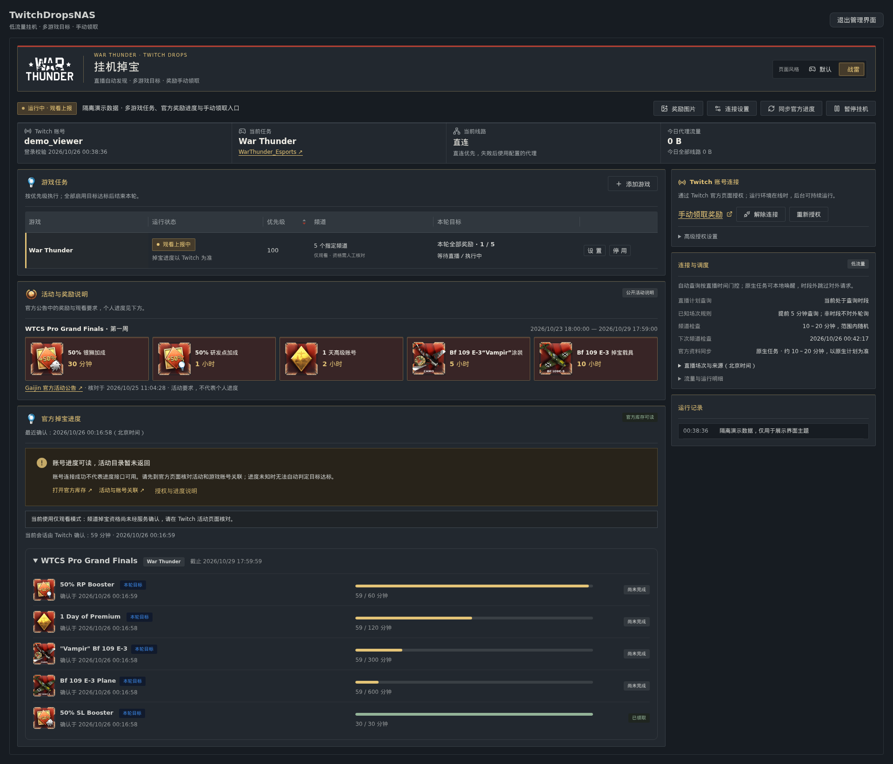
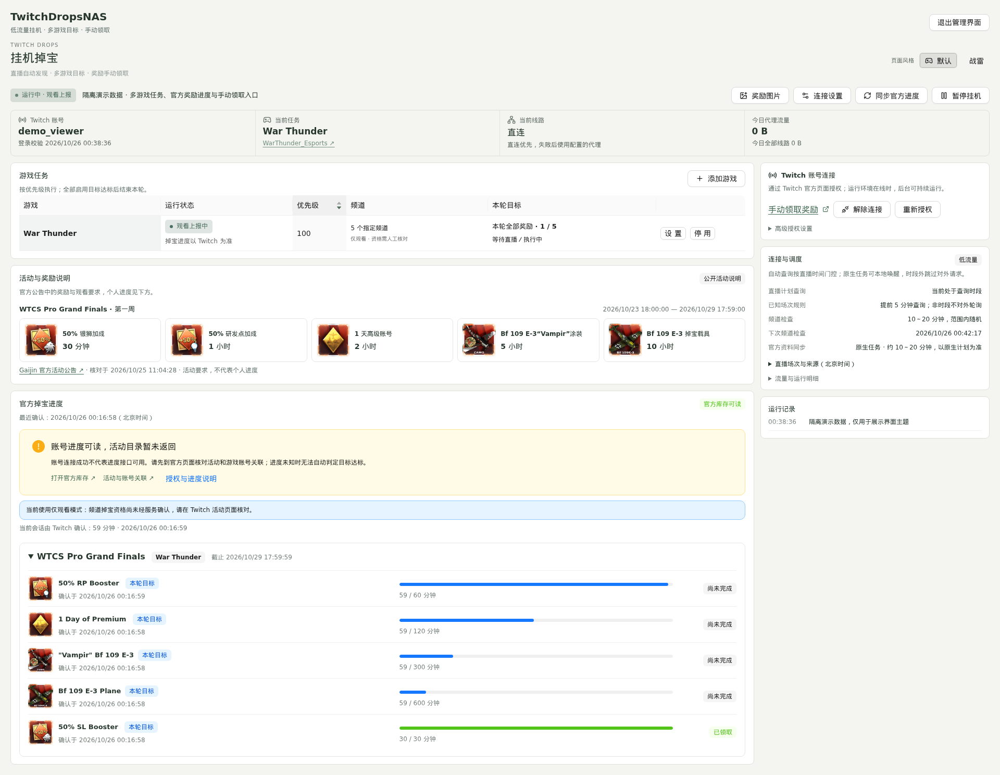
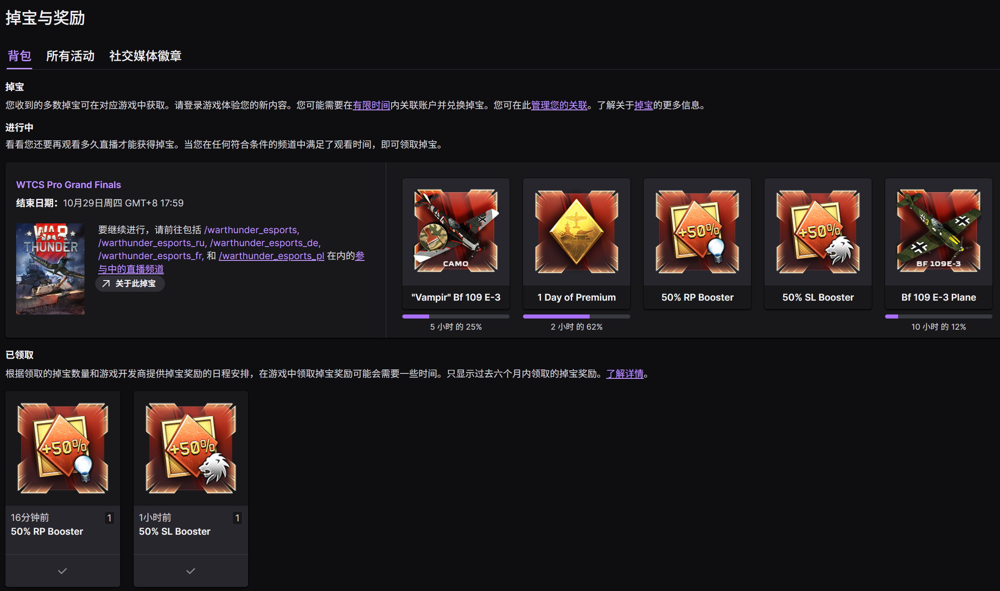

# TwitchDropsNAS

简体中文 · [English](README.en.md)

可自行部署的 Twitch Drops 管理服务：低流量观看、多游戏队列、奖励目标、独立 Web UI，以及 Agent / 控制台接入 API。MIT 开源。

部署位置由使用者选择：自己的 NAS／服务器，或具备运行条件的 WorkBuddy 执行环境。每个实例独立保存使用者的账号和数据，不依赖项目作者的 NAS、后台或代理。WorkBuddy 环境需要先检查，当前未完成 WorkBuddy 实测；参见 [WorkBuddy 部署条件](docs/workbuddy.md) 和 [通用 Agent 提示词](docs/agent-prompt.md)。

**当前状态（实验性）：** 2026-10-25 已在 Linux amd64 的真实战雷直播中读到有效奖励 ID、官方观看分钟及本轮奖励目标；2026-10-26 的 Twitch 库存截图进一步确认两项加成奖励已手动领取，见文末实测记录。观看使用播放列表元数据＋分片 HEAD 请求，不下载视频／音频正文。其他游戏、授权和部署环境仍需分别验证；完整一轮自动停止尚待实测。活动目录仍可能为空，不把 `null` 当成无活动或零进度；进度不可读时不承诺自动达标停止，遇完整性验证不绕过。

## 界面截图

以下两张图来自隔离的桌面演示页面，使用脱敏演示数据展示同一套 UI 的两种主题。它们用于展示界面；真实掉宝与领取结果见文末「真实效果验收」。

### 战雷主题

暗色机库面板、官方战雷图标和奖励卡片，适合战雷活动管理。



### 普通样式

保留相同的任务、进度和账号操作，页面右上角可随时切换主题。



<details>
<summary>连接设置与奖励图片导入</summary>


</details>

## 功能

- Twitch 官方设备授权：在 Twitch 激活页登录，后端不接收邮箱密码。
- 一个账号、最多 12 个游戏任务；优先级调度、指定频道、自动发现开播。
- 选择本轮全部奖励，或指定同一游戏不同活动中的奖励。
- 全部模式锁定本轮目标，未来活动不会自动加入；未知资料不当作 0 或完成。
- Twitch 确认已领取、可领取，或观看时长达到官方要求后，停止该目标的观看。
- 前置奖励等手动领取时，继续其他可进行目标；全部启用游戏目标达标后自动结束本轮。
- 不自动领取，不下载视频或音频正文；仅读取播放列表元数据、对分片发送 HEAD 检查；没有小时／每日流量配额。
- 独立 UI 和嵌入控制台使用同一组件、同一 API；后端可仅启用 Unix socket。
- 页面右上角可独立选择“默认／战雷”风格，包含官方 Logo、研发点和护身符图标、暗红奖励卡及游戏式面板。选择只保存在当前浏览器，不改变宿主管理台的全局主题；官方素材直接使用原始 HTTPS 地址。

## Docker 启动

```sh
git clone https://github.com/MrTreasure/TwitchDropsNAS.git
cd TwitchDropsNAS
docker compose up -d --build
# 仅首次安装需要：在自己的终端读取自动生成的管理令牌
docker compose exec drops cat /data/admin-token
```

默认启用独立 Web UI；设置 `TDM_WEB_UI=false` 可关闭页面并保留 API／后台任务。打开 <http://127.0.0.1:8080>，用管理令牌登录，再连接 Twitch、完成官方授权、同步资料、设置游戏和奖励目标并开始挂机。远程 NAS 可先使用 SSH 端口转发：

```sh
ssh -L 8080:127.0.0.1:8080 user@your-nas
```

Compose 默认只绑定主机回环地址。使用 HTTPS 反向代理时，设置 `TDM_PUBLIC_ORIGIN=https://drops.example.com`，保留 Host；浏览器使用 HttpOnly 会话 Cookie，Agent 使用 Bearer 管理令牌。Twitch 凭据与管理令牌不同。

数据位于 Docker 命名卷 `drops-data`。升级前备份此卷；不要使用 `docker compose down -v` 进行普通升级。容器默认 UID/GID 为 1000:1000，宿主机目录挂载需提前赋予该 UID 写入权限。

## 如何添加挂机任务

1. **连接账号：** 在「Twitch 账号连接」获取授权码，到 Twitch 官方页面批准。然后在 [Twitch 活动页](https://www.twitch.tv/drops/campaigns) 确认游戏账号已关联。
2. **选择活动：** 点击「游戏任务 → 选择掉宝活动」，按游戏名或活动名搜索。列表支持进行中、未开始和全部活动；点击「选择活动与奖励」。没有资料时先点「同步活动资料」，等待同步完成。
3. **确认奖励：** 游戏名称自动填写，默认选中此次活动的全部奖励，可取消不需要的奖励。同一游戏已有任务时，会把所选活动奖励加入原目标草稿，保留原频道、优先级和查询计划；只有保存后才生效。
4. **保存并开始：** 点击「保存并开始挂机」。只想先配置可点「保存任务」，随后用页面顶部「开始挂机」启动。正在运行的队列保存后会继续按优先级执行；停用的任务须先勾选启用。
5. **手动领取：** 到 [Twitch 背包](https://www.twitch.tv/drops/inventory) 领取，前置奖励领取后同步进度，后续目标才能继续。

一个账号最多配置 **12 个游戏任务**，同一游戏可包含多个活动的奖励，**同一时间观看一个频道**。优先级高的可执行任务先进行；所有启用任务的非空目标都经官方确认达标后自动结束本轮。

**列表不完整时：** Twitch 可能返回库存但不返回活动目录，页面会明确提示，仅展示已取得的官方活动。可用「手动添加游戏」填写 Twitch 游戏名称，选择「此游戏当前活动的全部奖励」，待正式资料返回后锁定目标。公开公告不能代替官方奖励 ID；不要把活动有效期当作直播开播时间。界面截图展示主题，按钮流程以本节为准。

## 网络与省流

默认先匿名检查直连，失败后使用显式配置的代理。未配置代理时报告连接失败，不自动读取系统代理。需要代理时复制 `.env.example` 为 `.env`，设置容器内可访问的 HTTP 代理地址 `TDM_PROXY_URL`，然后重建容器。`127.0.0.1` 在容器里指容器自身；宿主机代理需要使用容器可达地址。

也可只读挂载原有 mihomo 配置与二进制，设置 `TDM_PROXY_SOURCE`、`TDM_PROXY_NODE`、`TDM_MIHOMO`，只使用明确指定的节点。临时配置通过 Linux memfd 传入，不复制节点密钥到磁盘。项目不包含、推荐或自动选择任何代理供应商。

复用连接；观看链路约每 20 秒读取低带宽直播播放列表、对其中分片发送 HEAD 请求，缓存播放清晰度地址，不下载分片正文；离线频道批量检查；空闲频道默认随机间隔 10～20 分钟检查；独立模式的资料同步也采用随机区间；库存通常缓存 30 分钟，等待前置领取时随下一次资料检查更新；活动目录缓存 1 小时，元数据缓存 6 小时。手动同步可立即更新。计量值不是服务商账单，外部 HTTP 代理的开销按估算记录。

## 按直播时间查询

默认优先使用已核对的直播场次，开播前 **5 分钟**开始查询，并在预计开播时再次检查。活动可领取时间不等于直播时间；没有正在观看的直播时，已知场次以外不启动频道发现与自动资料同步。近期直播记录可在重启后恢复为待核对候选，重新确认在线后继续观看。原生定时执行器仍可做本地门控检查，并如实记为跳过。

任务设置可选「按已公布场次」「自定义直播时间」「不限时间」。自定义输入使用北京时间；没有场次资料的其他游戏保留低频随机查询。当前内置 2026 WTCS 总决赛官方公布的 18 场正赛／直播重播时间，来源与核对时间会显示在界面；不是网页 VOD。

预计开播后 1 小时仍未找到直播，会等待下一场；已找到的真实直播不会因为这个等待上限被切断。临时加播或超时开播可补充时间，或切换不限时间查询。手动同步仍可在窗口外使用。详情见 [API 的直播计划说明](docs/api.md#scheduled-stream-queries)。

## 目标与停止规则

1. **全部奖励：** 保存时锁定当前可见的活动奖励；资料尚未到达时，等待首次完整活动资料后锁定。之后的新活动不自动加入。
2. **指定奖励：** 按活动多选奖励；只接受已读取且属于此游戏的奖励 ID。
3. **达标：** 以官方数据为准。领取和观看达标分开显示，达到目标即可结束观看，不要求最后的奖励已手动领取。
4. **前置：** 只检查所选目标的依赖链。等领取时跳过对应分支，其他可进行目标继续。
5. **完成本轮：** 所有启用任务的非空目标集合均达标，持久化结束状态。重启不会重新挂机。开始新一轮需重新设置目标。
6. **未知／过期：** 不推算完成、不用本地计时替代官方进度。活动过期且未达标时等待管理员调整目标。

尚未取得活动资料时可显式启用仅观看模式，但无法保证掉宝资格或自动识别达标。只有收到官方奖励资料后才能锁定目标和验证完成。只有参与活动的直播可累计，VOD 回放不累计。

## 嵌入已有控制台

- 后端：仅启用 Unix socket，或使用带 Bearer 鉴权的 HTTP API。
- UI：复用 `ui/src/TwitchDrops.tsx` 与 `twitch-drops.css`，传入 `apiBase`；可选传入定时任务页面地址和宿主导航回调。
- Unix socket 必须只允许受信宿主读取。宿主负责自己的登录、权限、Origin 和 actor 校验；不要直接对外代理该 socket。
- 私有宿主集成说明：[docs/embedding.md](docs/embedding.md)。Agent 可用提示词：[docs/agent-prompt.md](docs/agent-prompt.md)。

## 配置

| 环境变量 | 默认值／用途 |
|---|---|
| `TDM_DATA_DIR` | 原生 `./data`，Docker `/data`，私有状态与凭据目录 |
| `TDM_SOCKET` | 原生默认关闭；Docker `/run/twitch-drops/service.sock`，Unix 权限 0600 |
| `TDM_WEB_UI` | `true`；关闭独立页面，保留 API 与后台任务 |
| `TDM_HTTP_PORT` | `8080`；设为 `0` 禁用 TCP / 独立 UI |
| `TDM_HTTP_HOST` | 原生 `127.0.0.1`；Docker `0.0.0.0`，配合 Compose 主机回环绑定 |
| `TDM_ADMIN_TOKEN` | 可选，至少 24 字符；未配置时生成 `/data/admin-token` |
| `TDM_PUBLIC_ORIGIN` | 可选，反向代理的完整公网来源 |
| `TDM_PROXY_URL` | 可选，外部 HTTP/HTTPS 代理；不与内置 mihomo 同用 |
| `TDM_PROXY_SOURCE` / `TDM_PROXY_NODE` | 可选，只读 mihomo 原配置及指定节点 |
| `TDM_MIHOMO` | `/usr/local/bin/mihomo`，需自行只读挂载兼容二进制 |
| `TDM_PROXY_LABEL` | 可选，界面上的非敏感代理显示名 |
| `TDM_EXTERNAL_SCHEDULER` | `false`；设为 `true` 时关闭服务内随机资料检查，改由唯一外部执行器调用 |
| `TDM_EXTERNAL_CHECK_MIN_SECONDS` / `TDM_EXTERNAL_CHECK_MAX_SECONDS` | 外部计划在 UI 中的说明范围，默认 600 / 1200 秒；须与真实原生计划一致，并不修改原生计划 |
| `TDM_STREAM_SCHEDULES_FILE` | 可选，替换公开直播场次文件；日期必须包含时区，默认使用内置场次 |
| `TDM_ANNOUNCEMENTS_FILE` | 可选，管理员维护的公开活动说明 JSON；默认使用内置的已核对公告，仅展示说明，不作为个人进度或奖励 ID |
| `TDM_PASSWORD_BOOK` | 可选 YAML 凭据宿主适配器，只修改 `twitch_drops.account`；未配置则用 `/data/credentials.json` |

## 授权与进度不可读

未连接或登录失效时，界面提供官方设备授权；已连接但进度不可读时，明确显示两者的区别，并提供官方库存、游戏关联入口和处理步骤。目前没有核实到供普通观众额外开启进度读取的 OAuth 授权项，重复授权不保证恢复读取。详见 [授权说明](docs/authorization.md)。

## 调度与 Agent

独立部署默认在 10～20 分钟范围内重新随机选择资料检查间隔，可通过 `/api/automation` 查询启停和真实执行状态。开启／暂停挂机与启停资料同步是两个独立开关。

若宿主已有 cron、systemd 或任务控制台，使用 `TDM_EXTERNAL_SCHEDULER=true`，只登记原生执行器；不要再建另一份业务计划。附带的 systemd 示例使用 上次检查结束后等待 10 分钟，再加 0～10 分钟随机延迟；启动时另有一次初始检查，不声明这能避免平台识别。`deploy/` 提供 systemd 模板。HTTP 保活和观看心跳不是资料同步调度。

[API 文档](docs/api.md) · [OpenAPI](docs/openapi.json) · [Agent 接入提示词](docs/agent-prompt.md)

## Release 与启动选择

GitHub Release 提供 Linux amd64／arm64、Windows amd64／arm64、macOS Intel／Apple Silicon 六个平台的压缩包和 SHA256SUMS。下载自己平台的包，先校验 SHA-256，再解压运行；无需 Python、Go、Node.js 或 Docker。候选版用于验收，平台实际运行验证情况以 Release 说明为准。

交互式终端直接启动时会询问是否启用独立 Web UI。无人值守运行请明确选择：

```sh
./twitch-drops --web-ui=true   # 独立 UI + API
./twitch-drops --web-ui=false  # 只运行 API 和后台任务
```

Windows 对应 `twitch-drops.exe`。也可设置 `TDM_WEB_UI=true/false`。关闭 Web UI 后 `/` 和 `/assets/*` 返回 404，管理 API 继续鉴权，不影响观看、调度和已有控制台；需要完全关闭 TCP 时另设 `TDM_HTTP_PORT=0` 并提供受信 Unix socket。嵌入已有管理台的实例使用 `TDM_WEB_UI=false`，复用管理台中的界面。

## Go 二进制与本地开发

后端使用 Go，运行时不需要 Python、Node.js 或独立 SQLite 服务。UI、公开活动说明与 OpenAPI 嵌入可执行文件；Node.js／pnpm 只在构建 UI 时需要。

源码构建需要 Go 1.26.5、Node.js 26 和 pnpm 12.3.4：

```sh
sh scripts/build.sh
# 默认只监听 127.0.0.1:8080，数据保存在当前目录的 data/
./dist/twitch-drops
# 首次启动后，在自己的另一终端查看管理令牌，不要贴到聊天中
cat data/admin-token
```

可通过 `TDM_DATA_DIR` 指定自己的私有持久目录。原生模式默认不创建 Unix socket；只有接入本机网关或原生调度器时才设置 `TDM_SOCKET`。Windows 使用针对 Windows 构建的 `.exe`，不配置 Unix socket；当前已完成跨平台编译，Windows/macOS 的真实运行尚待验证。内置 mihomo 的匿名内存配置仅适用于 Linux，其他系统使用直连或明确配置的 HTTP/HTTPS 代理。

常规验证：`go vet ./...`、`go build ./...`、`pnpm --dir ui run typecheck`、`pnpm --dir ui run build`，以及有界的健康与 API 检查。UI 交互由人工验收，不默认运行浏览器自动化。

完整 Dockerfile 在多阶段构建中编译 UI 和 Go；已经执行 `sh scripts/build.sh` 时，可用 `docker build -f Dockerfile.runtime -t twitch-drops-nas:2.0.0 .` 构建精简运行镜像。Go 模块和 UI 依赖均锁定版本。运行镜像不包含 Go 编译器、Node.js 或 Python。

## 说明与许可证

此项目与 Twitch、Gaijin 及任何游戏发行商无隶属关系。活动资格、奖励发放、授权范围及进度由 Twitch / 游戏发行商决定；遇验证或限流停止／退避，不绕过验证。参考项目和原版权声明见 [NOTICE.md](NOTICE.md)，本项目使用 [MIT](LICENSE)。

## 活动说明与账号进度

`catalogue/announcements.json` 是人工核对、带来源与核对时间的公开活动说明。目前包含战雷 WTCS 2026 第一周的 5 项奖励，来源是发行商官方公告，活动窗口参考 Twitch 活动页。它不是从私人库存推断的结果，不含账号关联、观看分钟数、领取状态或 Twitch 奖励 ID，不进入自动目标完成判定。其他游戏可由管理员按同样结构补充公开说明。

活动目录、活动详情和个人库存分别读取，接口字段必须是期望的列表类型；返回空值时显示能力未知／不可用，并保留真正确认过的数据。接口能力失败会退避缓存，手动同步可主动核对；遇完整性验证不会更换客户端头、生成校验令牌或绕过验证。

奖励卡片直接引用官方 CDN 原始 HTTPS 地址；浏览器懒加载图片，不经过 NAS 图片代理，不下载或转存原图。公开说明使用 `rewards[].imageUrl`，官方进度使用 Twitch 返回的 `benefit.imageAssetURL`。没有图片或加载失败时保留奖励名称、时长及明确占位。新增其他图片域名时须同步核对后端、UI 与宿主 CSP 的允许列表。

## 后续活动如何补充图片

正常同步时自动解析 Twitch 奖励的 `benefit.imageAssetURL`，其他游戏使用相同流程。接口未提供图片时，点击顶部「奖励图片」：选择所属活动，按界面脚本从已展开的 Twitch 活动页提取 JSON，或粘贴奖励区域 HTML，然后预览并确认保存。按活动、奖励名称、别名或附近文字匹配；其他游戏不会混入，歧义、无效地址和同一奖励的地址冲突会明确列出。也可在 JSON 中改为准确的奖励名称后重新预览。

导入结果只保存 CDN 地址及来源时间，持久化到 SQLite；无需改源码或重新部署。官方图片再次可读时优先使用官方数据。只有图片资料被更新，不会改变目标、观看分钟数、领取状态或授权。详细流程与 Agent API 见 [图片资料接入](docs/reward-images.md)。

## 隐私与开源边界

仅发布独立掉宝服务、可复用 UI 与公开说明；不包含部署方的真实账号标识、授权凭据、代理节点、NAS 目录、数据库、日志或其他后台源码。文末经使用者授权公开的库存截图仅展示活动、奖励、进度及领取状态。Twitch 公共 Client ID 和 GraphQL 查询哈希是公开互操作标识，不是用户 AK。真实管理令牌和 Twitch 凭据只保存在运行时私有存储中，不进入 API 快照、镜像构建上下文或 Git。

## 真实效果验收

下面是使用者于 **2026-10-26** 提供的 Twitch 官方「掉宝与奖励 → 背包」截图，记录了本项目运行期间的真实进度与手动领取结果：

- **已领取：** 50% SL Booster（银狮加成）、50% RP Booster（研发点加成）。
- **继续累计：** 1 天高级账号显示 62%，Vampir 涂装显示 25%，Bf 109 E-3 载具显示 12%。



这张图来自真实 Twitch 页面，非 AI 配图或界面演示数据；奖励、百分比和领取状态保持原样。截图已检查，不含账号昵称、邮箱、访问令牌或私有部署地址。

本次记录验证了战雷活动中的官方计时与两项奖励的手动领取。其他游戏、账号和运行环境仍需分别验证；整轮全部目标完成后的自动停止尚待实测。
